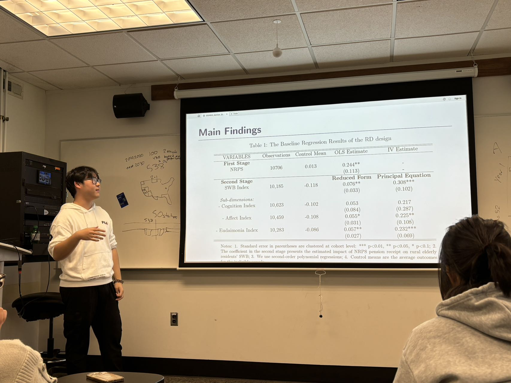
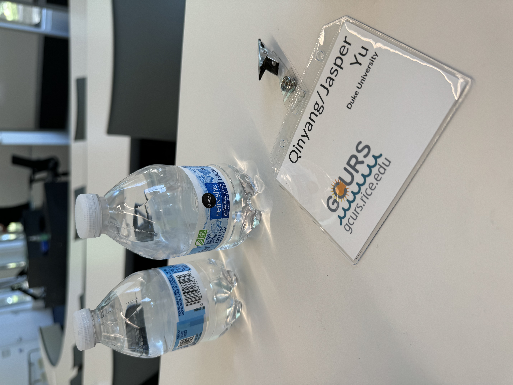
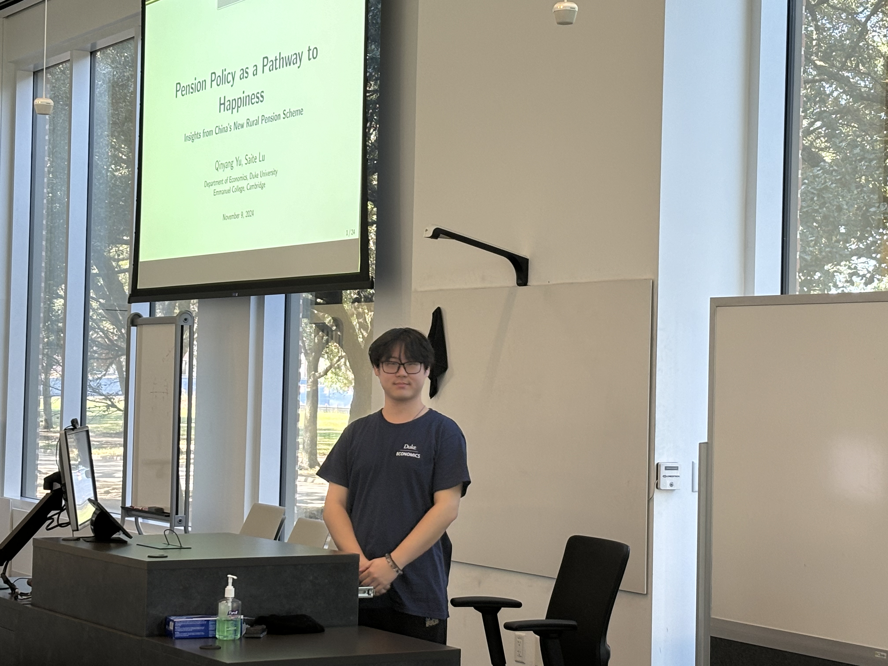
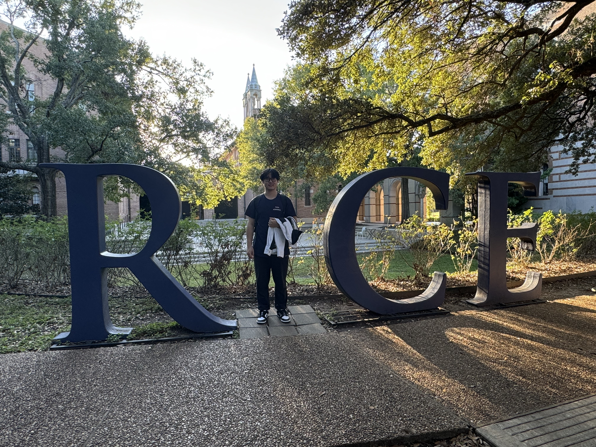
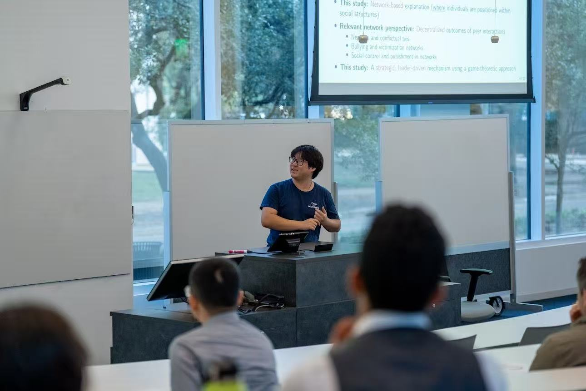
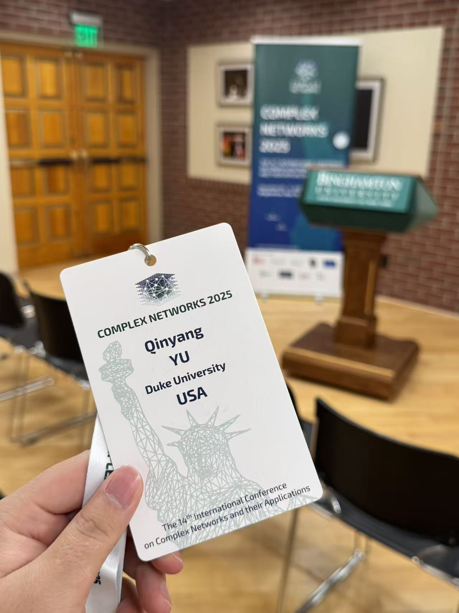

# Conferences
### Who Gets the Blame? A Structural Theory of Scapegoating in Social Networks
- Accepted for Presentation at [NetSciX 2026 - International School and Conference on Network Science](https://netscix2026.github.io/)
- Presented at [Complex Networks 2025 - The 14th International Conference on Complex Networks and their Applications](https://complexnetworks.org/)
- Presented at [2025 Missouri Valley Economic Association (MVEA) Annual Meeting](https://www.mvea.net/annual-conference.html)
- Presented at [2025 Gulf Coast Undergraduate Research Symposium (GCURS), Rice University](https://gcurs.rice.edu/)
- Published in the [Duke Journal of Economics (Vol. 37, Summer 2025)](https://sites.duke.edu/djepapers/2025/07/31/vol-xxxvii-summer-2025/)  

### Pension Policy as a Pathway to Happiness: Insights from China’s New Rural Pension Scheme  
- Presented at the [2025 Academic Annual Conference of the Chinese Sociological Association](http://csa.cass.cn/)
- Presented at the [2024 Gulf Coast Undergraduate Research Symposium (GCURS), Rice University](https://gcurs.rice.edu/)  
- Presented at the 2024 Master’s Research Seminar, EMAC, Duke University
- Published in the Fairy Lake Economic Journal, a student academic journal at CUHKsz

  

    
    
    
    
    
    
    <button class="nav prev" aria-label="Previous image">‹</button>
    <button class="nav next" aria-label="Next image">›</button>
  

  

